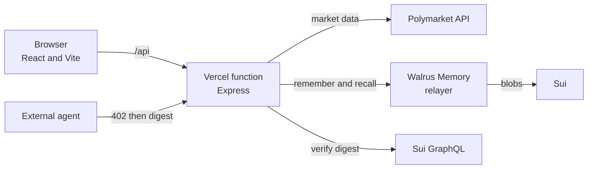
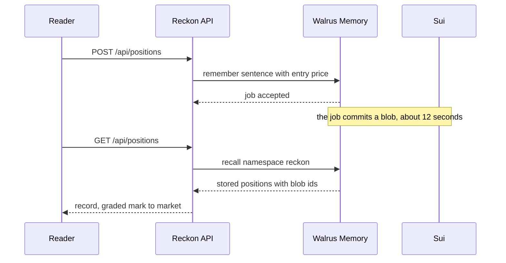
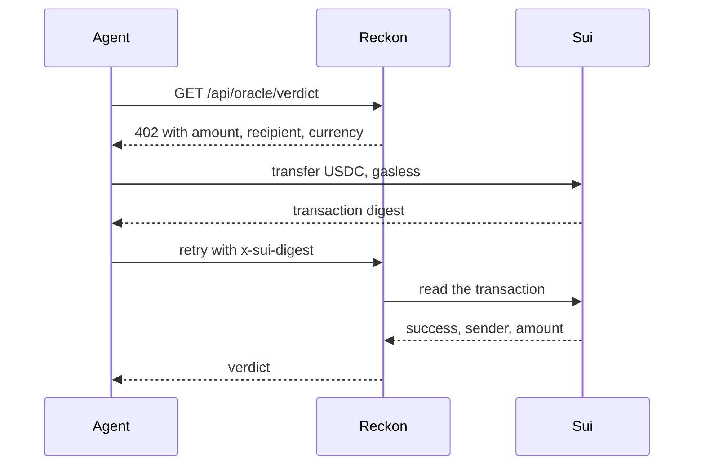

# Reckon

A forecasting record you can audit.

Reckon takes positions on live prediction markets and writes each one to Walrus
Memory before the outcome is known. When a market moves, the position is graded
against the current price. Because the write is timestamped on Sui, the record
cannot be edited after the fact.

Live application: https://reckon-three-beta.vercel.app
Judges briefing: https://reckon-three-beta.vercel.app/judges

## The problem

Forecasters claim accuracy after the fact. The misses are deleted and the hits are
posted. A reader has no way to tell a good record from a well edited one, because
nothing about a screenshot proves when it was taken.

A prediction market tells you the current consensus price. It does not tell you
whose opinion is worth trusting. That requires a track record, and a track record
is only meaningful if it cannot be rewritten.

## What Reckon does

1. Reads live markets from Polymarket's public API with their current prices.
2. Takes a position and writes it to Walrus Memory with the price at that moment.
3. Grades every position against the live price, mark to market.
4. Sells a verdict to software agents over x402, paid in USDC on Sui.

Grading is mark to market rather than resolution. These markets resolve months
from now, so a resolution based design would show nothing for weeks.

## Architecture



The frontend is static. Every route under `/api` runs in one serverless function.
Nothing in the browser ever sees a credential.

## The position lifecycle



Walrus Memory is the source of truth. The local file is a cache only, because a
serverless instance does not keep one between requests.

## Paying as a software agent

An agent cannot sign up for an account. It has no email address and cannot accept
terms. The endpoint answers with a price instead.



One digest buys one call. The digest is stored and replaying it is refused.

## How it was built

The application was generated with Tatum AI Builder from a written specification,
then extended by hand. The repository history shows both: ten commits authored by
`AI Builder <ai-builder@tatum.io>` and the rest by hand.

Tatum account: `6addae51f9f9306c432153f9`

## Integrations

| Service | Used for |
| --- | --- |
| Walrus Memory | every position, one namespace per app, recalled by meaning |
| Tatum | server side key handling and on chain verification |
| Sui | blob storage for memories, and settlement for agent payments |
| x402 through suimpp | the payment scheme for agent access |
| Polymarket | live markets and prices, read only |

## Honest limits

- x402 on Sui uses `suimpp`, a draft community scheme. Coinbase's x402 does not
  list Sui as a supported network.
- Polymarket is read over a public API. Reckon never transacts on Polygon.
- Tatum's Sui JSON-RPC host does not exist, so on chain verification currently
  uses Sui GraphQL. The code carries a TODO naming the Tatum Sui gRPC host.
- Recall is bounded at 15 seconds. Past that the record is served from cache and
  the page says so rather than showing a short list as if it were complete.
- These markets have not resolved, so the record shows movement, not accuracy.

## Running it

```
npm install --legacy-peer-deps
npm run build
npm run dev
```

Environment variables are listed in DEPLOY.md. None belong in the browser.
